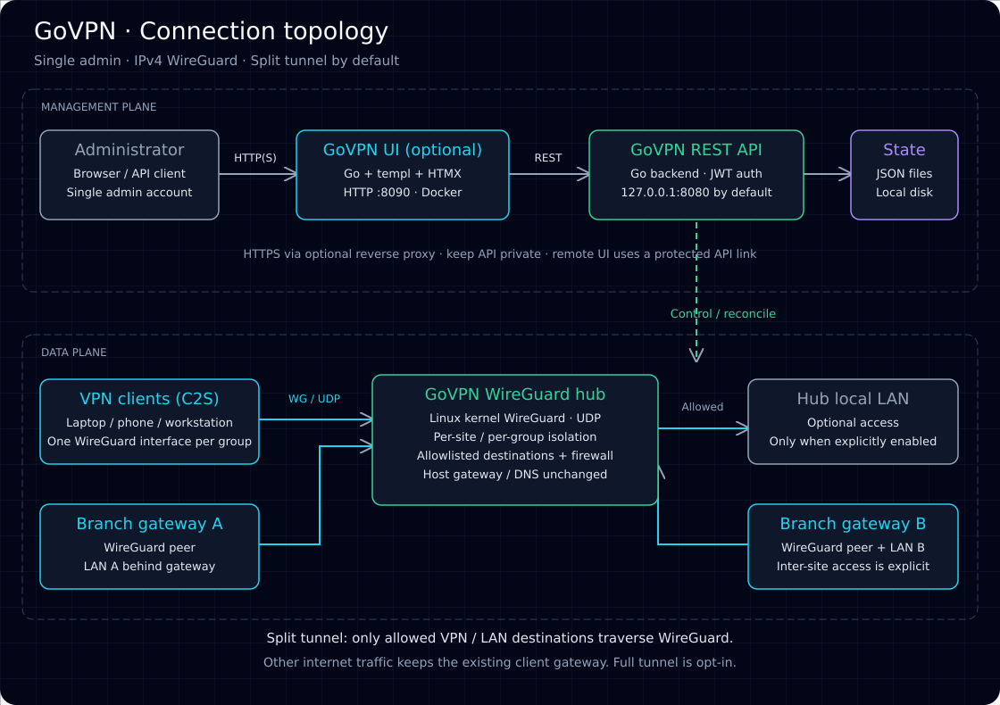
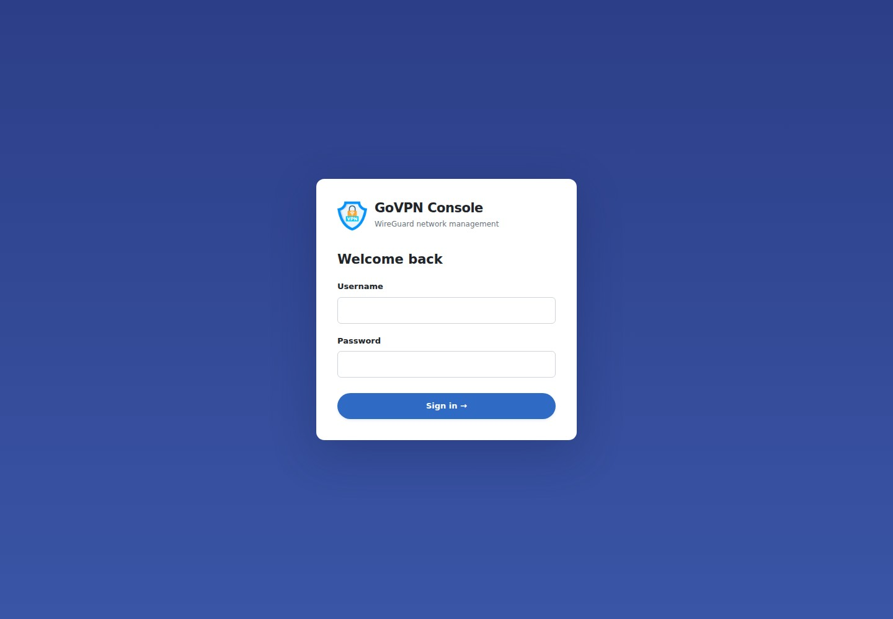
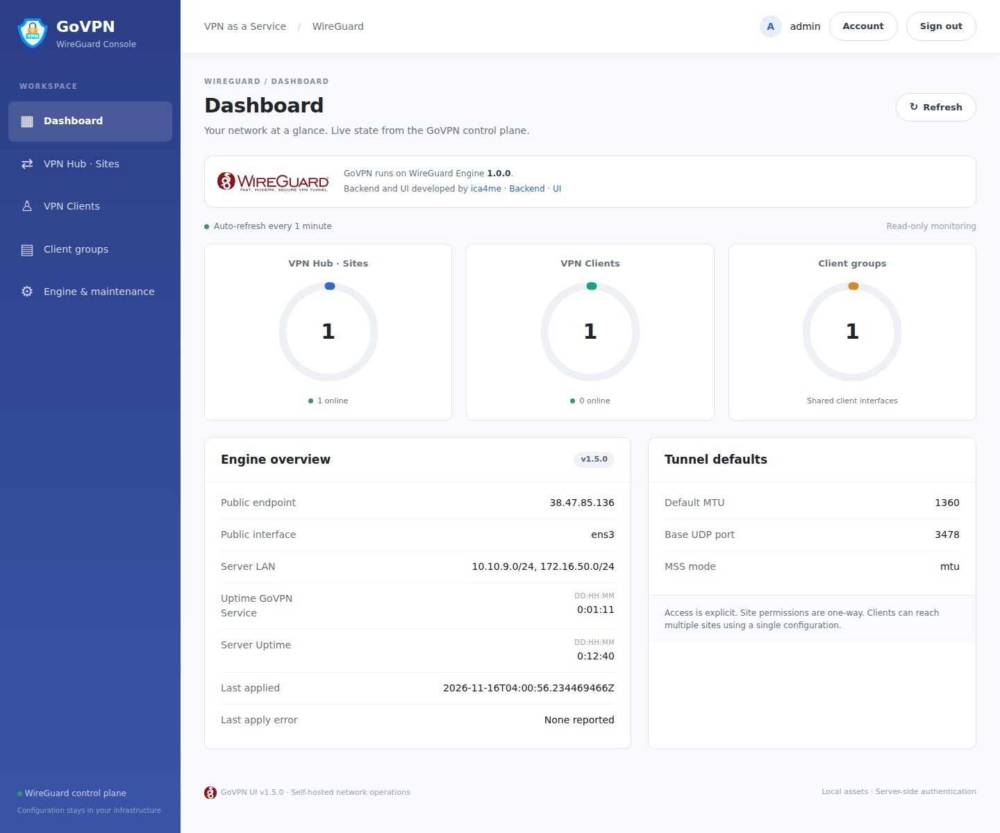

# GoVPN — WireGuard Engine (`govpn-wg`)

Engine VPN WireGuard berbasis Go untuk Linux, dikendalikan lewat REST API (JSON + JWT). UI terpisah tersedia secara opsional. Gratis dan open source untuk pemakaian individu.

- **VPN Hub / Site-to-Site** — tiap site (kantor/cabang) dapat interface WireGuard sendiri yang diberi nama dari nama site (`Kantor Pusat` → `wg-s-kantor-pus`).
- **Client-to-Site** — client (laptop/HP) masuk ke *group*; satu group = satu interface (`wg-c-default`, …). Client bisa diizinkan ke satu atau banyak site, dan secara default boleh mengakses LAN di belakang server.
- Subnet tunnel `/24` acak dari `172.31.201.0`–`172.31.250.0`, dicek agar tidak bentrok.
- Akses diatur per site/client dengan iptables. Defaultnya ditolak, kecuali diberi izin.
- Config client default **split-tunnel**, jadi internet client tetap lewat jalur aslinya. Server juga sudah menyiapkan NAT internet, sehingga client bisa pindah ke **full-tunnel** cukup dengan mengubah `.conf`-nya sendiri.
- Hanya IPv4. IPv6 dimatikan di setiap interface tunnel, sedangkan IPv6 host tidak diubah.
- Engine tidak menambah, menghapus, atau mengganti default gateway server.
- Perubahan lewat API diterapkan langsung tanpa restart interface.

**Penyimpanan:** state sites, groups, dan clients masih menggunakan file JSON (`/var/lib/govpn/wg/state.json`), **belum SQLite maupun database SQL**. Kunci dan hash password disimpan sebagai file terpisah.

## Topologi koneksi



UI bersifat opsional. Garis kontrol mengelola hub; trafik VPN lewat WireGuard. Default **split-tunnel**, akses antar-site dan LAN mengikuti izin yang dipilih.

## UI opsional

Repo UI: **https://github.com/ica4me/govpn-wg-ui** — Go + Templ + HTMX + Tailwind CSS, dijalankan melalui Docker Compose pada server backend atau server terpisah.

Instalasi UI **opsional**: seluruh operasi pengelolaan sudah tersedia melalui REST API. Lihat [daftar endpoint dan format API](docs/api/README.md), [autentikasi/password](docs/api/auth.md), serta dokumentasi request body untuk [sites](docs/api/sites.md), [groups](docs/api/groups.md), dan [clients](docs/api/clients.md). Contoh alur dan body JSON tersedia di [examples](docs/api/examples.md).

[Screenshot UI](docs/ui.md) · [Instalasi UI](https://github.com/ica4me/govpn-wg-ui#readme)

### Screenshot UI





Screenshot Sites, Clients, Groups, dan Maintenance terbaru ada di [galeri UI](docs/ui.md).


> Status: masih tahap pengujian. Lihat [docs/testing.md](docs/testing.md) sebelum dipakai di produksi.

---

## Instalasi (Linux fresh)

**Rekomendasi OS: Debian 13 Cloud**, untuk instalasi minimal yang ringan dan overhead rendah pada server tunnel. Kecepatan aktual tetap bergantung pada CPU, jaringan, dan konfigurasi VM.

Target dukungan: **Debian 12/13** serta **Ubuntu 22.04, 24.04, dan 26.04**, kernel ≥ 5.6 dengan modul `wireguard`. Pengujian server nyata saat ini dilakukan pada Debian 13; versi OS lain belum seluruhnya diuji end-to-end. Semua perintah dijalankan sebagai root.

### 1. Update sistem

```bash
apt update && apt -y upgrade
```

### 2. Pasang paket dasar

```bash
apt -y install git curl ca-certificates
```

Paket lain (`wireguard-tools`, `iptables`, `iproute2`, `ethtool`, dan sebagainya) dipasang otomatis oleh installer. Go juga diunduh otomatis kalau belum ada, jadi tidak perlu dipasang manual.

### 3. Ambil source code

```bash
cd /root
git clone https://github.com/ica4me/govpn-wg.git
cd govpn-wg
```

### 4. (VM cloud) Pasang pengaman cloud-init — disarankan

Pada image cloud (OpenStack, dan sejenisnya), cloud-init memproses **setiap** interface baru, termasuk interface WireGuard. Akibatnya DHCP di NIC publik bisa berjalan ulang dan route server berubah. Script berikut mengecualikan interface GoVPN saja. Hotplug untuk NIC fisik tetap berjalan seperti biasa.

```bash
bash deploy/cloud-init-guard.sh
```

Script ini aman dijalankan berulang. Kalau rule cloud-init tidak ada, script langsung keluar tanpa mengubah apa pun.

### 5. Jalankan installer

Mode interaktif (semua nilai ditanyakan):

```bash
bash scripts/install.sh
```

Atau langsung tentukan nilainya, misalnya mengganti port:

```bash
bash scripts/install.sh --yes \
  --port 51820 \
  --mtu 1360 \
  --server-lan 10.10.9.0/24 \
  --admin-user admin
```

Opsi yang sering dipakai:

| Opsi | Fungsi | Default |
|---|---|---|
| `--port N` | port UDP WireGuard pertama. Interface berikutnya memakai port selanjutnya (N+1, N+2, …) | `3478` |
| `--mtu N` | MTU default tunnel | `1360` |
| `--server-lan CIDR,...` | LAN di belakang server yang boleh diakses site/client (`none` = tidak ada) | hasil deteksi |
| `--api ADDR:PORT` | alamat REST API | `127.0.0.1:8080` |
| `--endpoint HOST` | IP/hostname publik yang ditulis ke config peer | otomatis |
| `--admin-user NAME` | username admin API | `admin` |
| `--admin-password PW` | password admin (minimal 8 karakter) | `admin` pada instalasi baru; hash lama dipertahankan |
| `--no-tune` | lewati tuning kernel/NIC | tuning aktif |

Semua opsi: `bash scripts/install.sh --help`, atau lihat [docs/installation.md](docs/installation.md).

Instalasi baru memakai password bootstrap `admin` jika tidak ditentukan. Segera ganti melalui [API password](docs/api/auth.md) sebelum digunakan di produksi. Instalasi ulang mempertahankan password yang sudah disimpan.

### 6. Buka port UDP di firewall provider

Buka UDP mulai dari port pertama (misalnya `3478`) sebanyak jumlah site + group yang akan dibuat.

### 7. Cek

```bash
systemctl status govpn-wg
curl -s http://127.0.0.1:8080/api/v1/health
```

API hanya listen di `127.0.0.1`. Dari komputer lain, akses lewat SSH tunnel:

```bash
ssh -L 8080:127.0.0.1:8080 root@IP-SERVER
# lalu buka http://127.0.0.1:8080 dari komputer sendiri
```

### Lupa username atau password

GoVPN hanya punya satu akun admin. Username dan password-nya bisa diganti di UI lewat menu **Account**, atau lewat API `POST /api/v1/auth/credentials`.

Kalau lupa, reset di server backend:

```bash
sudo /opt/govpn/wg/govpn-wg reset-admin
sudo systemctl restart govpn-wg
```

Login kembali menjadi **admin / admin**. Tunnel, site, dan client tidak tersentuh. Setelah login, kamu wajib mengganti password dulu (username boleh ikut diganti) sebelum bisa mengelola VPN.

### Mengubah pengaturan setelah install

Jalankan ulang installer dengan opsi baru. State, key, dan token tetap aman:

```bash
cd /root/govpn-wg
bash scripts/install.sh --yes --port 51820
```

Bisa juga mengedit `/etc/govpn/wg.env`, lalu jalankan `systemctl restart govpn-wg`.

### Update ke versi terbaru

```bash
cd /root/govpn-wg
git pull
bash scripts/install.sh --yes
```

### Uninstall

```bash
bash /opt/govpn/wg/uninstall.sh           # hapus service, interface, dan rule; data tetap disimpan
bash /opt/govpn/wg/uninstall.sh --purge   # hapus juga config dan seluruh key
```

---

## Mulai cepat

```bash
API=http://127.0.0.1:8080/api/v1
TOKEN=$(curl -s $API/auth/login -d '{"username":"admin","password":"PASSWORD"}' \
  | sed -n 's/.*"access_token": *"\([^"]*\)".*/\1/p')

# site (VPN Hub)
curl -s -X POST $API/sites -H "Authorization: Bearer $TOKEN" \
  -d '{"name":"Kantor Pusat","local_subnets":["192.168.10.0/24"]}'

# client (client-to-site)
curl -s -X POST $API/clients -H "Authorization: Bearer $TOKEN" \
  -d '{"username":"budi","target_sites":["kantor-pusat"]}'

# unduh config client
curl -s -H "Authorization: Bearer $TOKEN" $API/clients/budi/download/conf -o budi.conf
```

---

## Dokumentasi

Semua dokumentasi ada di folder [`docs/`](docs/README.md):

- [Instalasi & konfigurasi lengkap](docs/installation.md)
- [Arsitektur, jaringan & firewall](docs/architecture.md)
- **REST API**
  - [Ringkasan, autentikasi & format error](docs/api/README.md)
  - [Sistem](docs/api/system.md)
  - [VPN Hub — Site-to-Site](docs/api/sites.md)
  - [Group client](docs/api/groups.md)
  - [VPN Client — Client-to-Site](docs/api/clients.md)
  - [Contoh alur lengkap](docs/api/examples.md)
- [Pengujian](docs/testing.md)

## Lisensi

Lihat [LICENSE](LICENSE).
