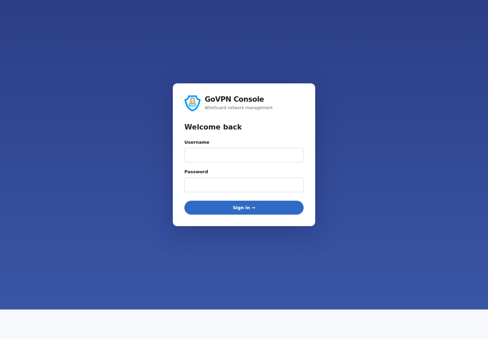
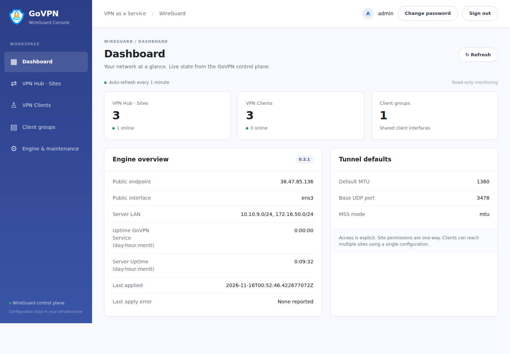
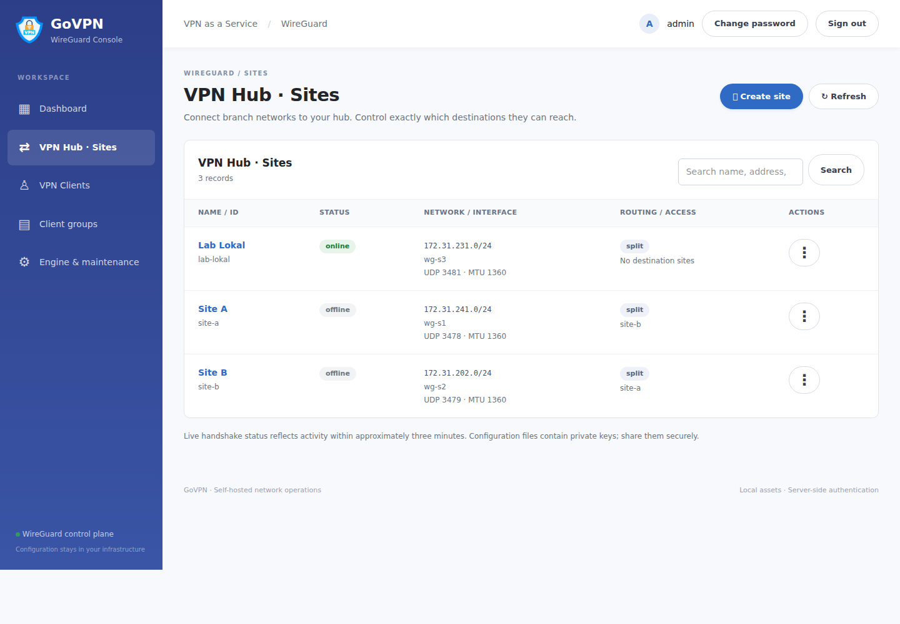
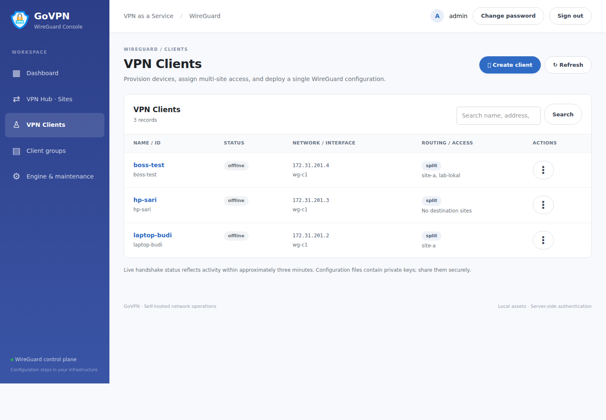
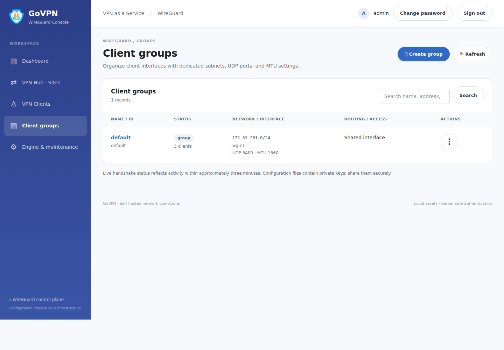
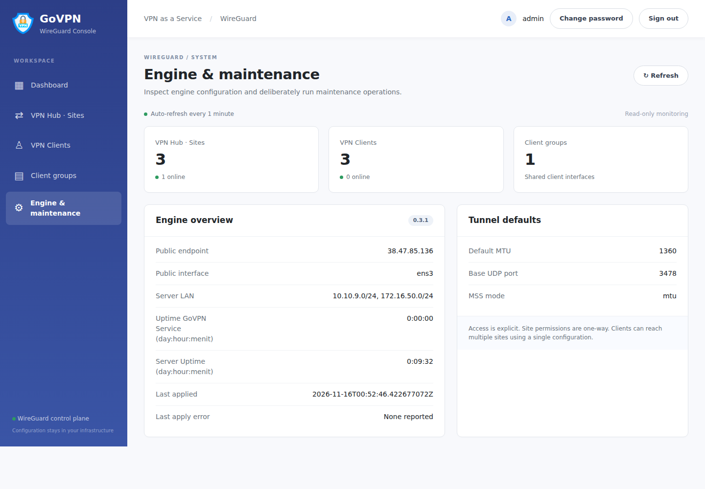

# UI opsional

Repo dan panduan instalasi: [govpn-wg-ui](https://github.com/ica4me/govpn-wg-ui). Backend dapat dioperasikan penuh lewat [REST API](api/README.md) tanpa memasang UI. Dokumentasi per endpoint menyertakan field request body, validasi, dan contoh JSON.

UI tidak menyimpan database VPN sendiri. State backend masih file JSON, belum SQLite.

## Login

## Dashboard

## VPN Hub / Sites

## VPN Clients

## Client groups

## Engine / Maintenance

